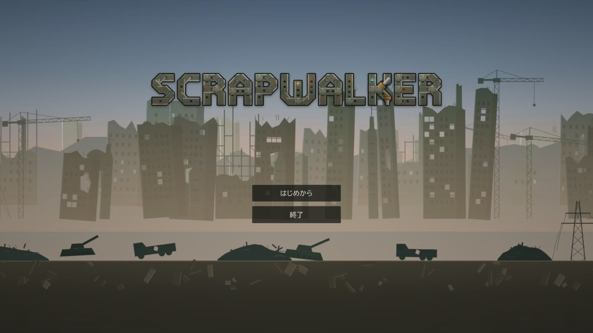
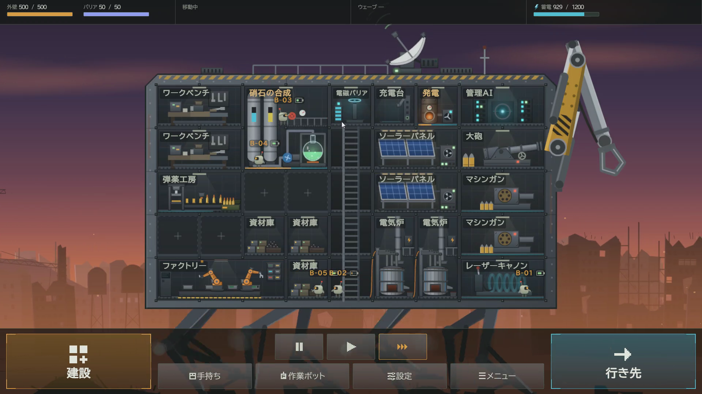
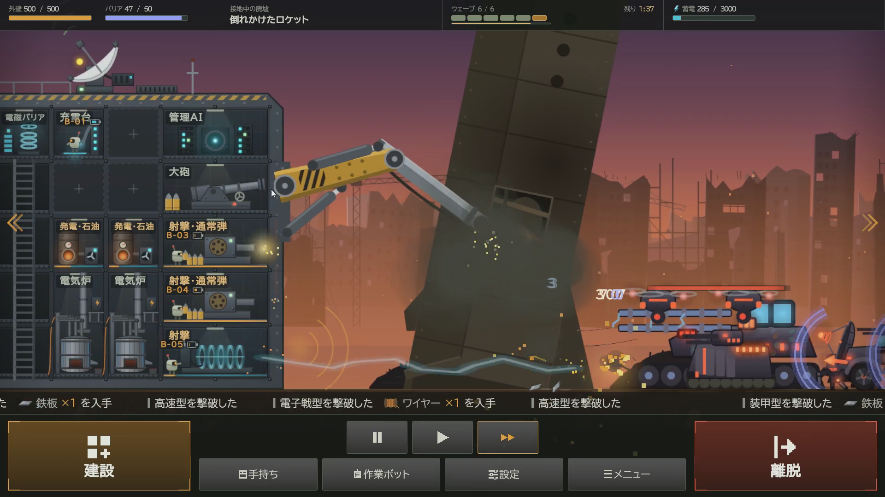

# Scrapwalker

**Scrapwalker** は、2D 横視点の工場建設とタワーディフェンスを合わせたゲームです。  
大きな移動拠点で廃墟を回り、集めた資材で拠点の中に工場と兵器を作って、襲ってくる敵から拠点を守ります。

目的は、拠点の離陸機能を直して、この星から脱出することです。  
本作では、**どの兵器で戦うかを決め、その兵器を動かすための工場を組み立てていくこと**を遊びの中心にしています。

---

## Quick Links

| 目的 | リンク |
|---|---|
| まずプレイ内容を見る | [Gameplay](#gameplay) |
| 操作を確認する | [Controls](#controls) |
| ゲームの特徴を知る | [Features](#features) |
| 設計意図を読む | [Design Highlights](#design-highlights) |
| 技術的な工夫を読む | [Technical Highlights](#technical-highlights) |
| アーキテクチャを見る | [Architecture](#architecture) |

---

## Project Summary

| 項目 | 内容 |
|---|---|
| Genre | 2D 横視点・工場建設 × タワーディフェンス |
| Platform | Windows 11 |
| Engine / Language | Unity 6（6000.3.23f1）/ C#、URP、UI Toolkit |
| 実装規模 | 約40,000行 |
| 開発メンバー | 1名（個人開発） |
| 担当範囲 | 企画・ゲームデザイン・設計・バランス調整 |
| 開発期間 | 2026年7月〜10月、約200時間 |
| 公開目的 | ポートフォリオとして、ゲームデザイン・実装・設計判断を確認できるようにするため |

---

## Gameplay

約4分20秒のプレイ動画です。  
チュートリアルから始まり、拠点の建設と生産、レーザーキャノンを作って建てるまでの流れ、廃墟でのウェーブの迎撃、最終ウェーブ、離陸までを確認できます。

<video src="./docs/videos/GamePlay.mp4" controls width="720"></video>

[動画を開く](./docs/videos/GamePlay.mp4)

---

## Overview

拠点の中は部屋に区切られていて、工場も兵器もそれぞれ1つの部屋として建てられます。  
作業用のロボット（ボット）が材料を部屋へ運び、そこで弾や部品を作ります。

プレイヤーは、次の流れを繰り返します。

1. **行き先を選ぶ。** 廃墟の中から、次に向かう所を選びます。廃墟ごとに、手に入る資材と、出てくる敵の種類や強さが違います。
2. **廃墟で資材を掘り出す。** 廃墟に着くと、拠点のアームで資材を掘り始めます。掘っている間は、敵が襲ってきます（ウェーブ）。拠点の兵器で迎え撃って、耐え抜きます。
3. **拠点を強化する。** 手に入れた資材で、新しい部屋を建てます。ボットが材料を部屋へ運び、弾や部品を作ります。
4. **より強い廃墟へ向かう。** 新しい兵器や設備がそろうと、もっと強い敵が出る廃墟にも挑めるようになります。

*拠点の様子です。部屋ごとに、弾を作る、発電する、撃つといった役割があり、ボットが材料を運んで動かしています。*

### 世界観

舞台は、核戦争の後に人類が去った星です。戦争のために作られた自律兵器「残留機兵」が、今も徘徊しています。  
主人公の技術者は、止まっていた拠点を起動し直し、拠点に乗ってこの星からの脱出を目指します。

---

## Features

- 移動拠点で廃墟を回り、資材を集めて拠点を強化する周回
- 撃つために必要な物が違う4種類の兵器（スクラップ投射機・マシンガン・レーザーキャノン・大砲）
- 有効な攻撃が型ごとに違う4種類の敵（高速型・装甲型・電子戦型・偵察型）
- すべての兵器で1体の敵を狙う「ロックオン」
- 制限時間つきのウェーブ（敵を倒しきらなくても、持ちこたえれば勝てる）
- 廃墟で拾うことも工場で作ることもできる資材
- 戦闘・生産・建設を同じ「タスク」として扱うボットの仕事の仕組み

---

## How to Play

### 目的

廃墟を回って資材を集め、拠点を強くしながら、より強い敵が出る廃墟へ進みます。最後は離陸機能を直して、星から脱出します。

### 基本ルール

- 廃墟で資材を掘っている間は、敵のウェーブが襲ってきます。
- ウェーブには制限時間があり、時間が来ると敵は引き上げます。
- 部屋のメニューからタスクを選ぶと、ボットが材料を運んで実行します。
- 兵器で撃つことも、生産や建設と同じタスクの1つです。

### Controls

タイトル画面の「はじめから」で始めます。操作はゲーム内の管理AIが案内します。  
操作はマウスだけです。

| 操作 | 入力 |
|---|---|
| 選択・決定 | 左クリック |
| 戻る | 右クリック / `Esc` |
| 画面を横に動かす | カーソルを画面の左右の端に寄せる |

---

## Design Highlights

### 戦いに使う兵器を選べるようにした

戦略が各プレイヤーで同じにならないよう、戦いに使う兵器をプレイヤーが選べるようにしました。  
兵器ごとに撃つために必要な物が違うので、選んだ兵器によって建てる工場が変わります。

| 兵器 | 内容 |
|---|---|
| スクラップ投射機 | 廃墟で拾ったスクラップを、そのまま撃ち出します。加工がいらない代わりに、威力は低めです。 |
| マシンガン | 弾薬工房で作った弾を撃ちます。弾を作り続ける設備が必要です。 |
| レーザーキャノン | 電気を使って撃ちます。弾はいりませんが、発電施設が必要です。 |
| 大砲 | 重い砲弾を撃ちます。砲弾には火薬が必要です。 |

幅広い戦略で、最後までクリアできるように調整しました。

### 敵の型ごとに有効な攻撃を変えた

| 敵の型 | 内容 |
|---|---|
| 高速型 | 1体ずつは弱いものの、足が速く、大勢で一度に襲ってきます。 |
| 装甲型 | 弾が当たるたびに、ダメージを一定の量だけ軽減します。小さな弾をたくさん撃つより、威力の大きい弾を1発当てるほうが有効です。 |
| 電子戦型 | 離れた所に止まって撃ってきます。バリアを張っていて、弾の威力に関係なく1発ずつ受け止めます。1発の威力の大きい兵器より、たくさん撃てる兵器のほうが有効です。 |
| 偵察型 | 自分では攻撃しませんが、近くにいる味方の傷を治し続けます。 |

どの兵器にも苦手な敵がいるので、1種類の兵器だけでは難しくなっています（不可能ではありません）。

また、どの敵から倒すべきかは場面によって変わるので、ウェーブの途中で敵をクリックすると、すべての兵器がその敵を狙う「ロックオン」の機能を入れました。たとえば、回復役の偵察型を真っ先に倒したいときに使います。

*最終ウェーブで、戦車の敵を迎え撃っている場面です。*

### 資材を拾うか、作るかを選べるようにした

資材の中には、廃墟で拾うことも、工場で作ることもできる物があります。

たとえば弾が足りないときは、弾がたくさん落ちている軍事工場の廃墟へ拾いに行くこともできますし、弾を作る設備を建てて自分で作ることもできます。どちらを選ぶかによって、次に向かう廃墟も、拠点に建てる部屋も変わります。

### テストプレイで決めたこと

最初から最後まで通して遊び、攻撃を重んじた組み方と、守りを重んじた組み方の2通りでクリアして比べました。

**敵を倒しきらなくても、時間いっぱい持ちこたえれば勝てるようにしました。** ウェーブには制限時間があり、時間が来ると敵は引き上げます。敵を全部倒す遊び方だけでなく、守りを固めて持ちこたえる遊び方も入れたかったからです。

実際に遊んでみると、電磁バリアをたくさん並べて守る組み方が簡単すぎました。とはいえ、バリアの耐久や置ける数を減らすと、守りで勝つ遊び方そのものが成り立たなくなります。  
そこで、バリアを並べるほど守りが固くなる点は残し、バリアの回復に使う電気の量を大きく増やしました。これにより、守りで勝つには発電量の多い拠点を作る必要があります。兵器をレーザーキャノン1台ほどに抑えた組み方でも、厳しいながら最後までクリアできます。

---

## Technical Highlights

| 項目 | 内容 |
|---|---|
| Task System | 戦闘・生産・建設を、ボットの「タスク」という1つの仕組みで動かす |
| Data-driven Components | 部屋や敵の種類ごとの違いを、コードの場合分けではなくデータに組み込んだ部品で表す |
| Rule / View Separation | ゲームの規則と進行を Unity に依存しない C# のコード（Core）にまとめ、Unity の側（Game）は入力・画面・描画・音だけを担当する |
| Preview | 「置けるか・押せるか・止まっている理由」を、実行と同じ検査を通す下見で出し、画面の表示と実際の可否が食い違わないようにする |

### 戦闘・生産・建設を、1つの仕組みで動かした

拠点の部屋には、それぞれタスク（その部屋で行う作業）の「実行予定」があります。プレイヤーが部屋のメニューからタスクを選ぶと、そのタスクが実行予定に並びます。ボットは、実行予定のタスクを上から順に実行していきます。1つのタスクでは、材料を部屋へ運び込み、部屋で作業をして、できた物を部屋の前に置きます。

兵器で撃つことも、弾の生産・発電・研究・ボットの製造・部屋の改造と同じ「タスク」の1つです。材料の運び込みやボットの割り当ては、どのタスクも共通の仕組みで行います。

割り当ての対象は、部屋のタスクだけではありません。部屋の建設と解体、外壁の修理、床に落ちた物の片付けも同じ「ボットの仕事」として扱い、そのとき実行できる仕事のうち優先度が一番高いものを、一番近い手の空いたボットに渡します。敵が来ると射撃の仕事が実行できるようになり、ボットは特別な指示なしで兵器の部屋へ向かいます。

この仕組みには、遊ぶ側と作る側の両方に利点があります。プレイヤーにとっては、覚える操作が「部屋にタスクを加える」の1つだけで済みます。開発する側にとっては、運搬や割り当てが共通の仕組みになっているので、新しいタスクを簡単に追加できます。

### 種類ごとの違いを、データに持たせた部品で表した

部屋や敵の種類ごとの違いは、コードの中の場合分けではなく、データに組み込んだ部品で表しています。

- **部屋**：兵器・倉庫・バリア・充電・蓄電・はしごなど、役割ごとの部品を組み合わせて作ります。兵器の部品を持つ部屋だけが撃てて、倉庫の部品を持つ部屋だけが物をしまえます。
- **敵**：回復やバリアも、それを持つ型にだけ付ける部品です。

新しい部屋や敵を足すときは、部品を組み合わせたデータを1つ作るだけで済みます。

---

## Architecture

ゲームの規則と進行は、Unity に依存しない C# のコード（Core）にまとめ、Unity の側（Game）は入力・画面・描画・音だけを担当しています。  
規則の部分は Unity を起動しなくても動かせるので、約430件の自動テストで動作を確かめています。

| asmdef | 役割 |
|---|---|
| `Assets/Scripts/Core` — `Scrapwalker.Core` | 規則・状態・コマンド・出来事。ほかの asmdef を参照しない |
| `Assets/Scripts/Game` — `Scrapwalker.Game` | 描画・画面・入力・音。Core を参照する |

Core は `Simulation.Tick()` で進み、入力は `Simulation.Execute(Command)` で受け取ります。表示側は `World` を読み取り、`DrainEvents()` で受け取った出来事をもとに画面を動かします。

画面は UI Toolkit で作っています。配置は UXML、見た目は USS で書き、C# は値を入れるだけにしています。`Assets/Scripts/Game/UI/HUD.uxml` が画面ごとの UXML・USS（`Assets/Scripts/Game/UI/Screens/<画面名>/`）を並べ、各画面の C# を `HUDView` がまとめて動かします。

---

## Development Background

拠点を作って運営していくゲームが好きで、移動拠点もモチーフとしてかっこいいと感じていたため、この2つを組み合わせたゲームを作りたいと考えました。  
同じ組み合わせのゲームはすでにあり、そこでは戦闘がおまけに近い形でも成り立っていましたが、戦闘をもっと大きく軸に置けるのではと考えました。

---

## Repository Notes

このリポジトリは、ポートフォリオとして公開することを目的としています。

以下の理由により、リポジトリ単体では Unity 上で完全には再現できません。

- 効果音ラボの効果音（`Assets/Audio/SE` の21個）は再配布が許可されていないため、含めていません。ソースから開いた場合は、その音が鳴りません。
- テストと、エディタだけで使うコード（絵の取り込み・定義の検査など）は含めていません。
- 画面の字体には、Windows に入っている BIZ UDPゴシックを実行時に読み込んで使っています。

起動するときは `Assets/Scenes/SampleScene.unity` を開いて Play します。

---

Credits

本作では、以下のソフトウェア、ライブラリ、アセットを使用しています。

### Engine / Packages

| Name | Provider | License |
|---|---|---|
| Unity | Unity Technologies | Unity Terms |
| Universal Render Pipeline / Input System / UI Toolkit / uGUI / TextMesh Pro | Unity Technologies | Unity Terms |

### Libraries

| Name | Author / Organization | License |
|---|---|---|
| Json.NET（Newtonsoft.Json） | James Newton-King | MIT License |

### Fonts

| Font | License / Notes |
|---|---|
| BIZ UDPゴシック | Windows に入っている字体を実行時に読み込む（リポジトリには含まない） |
| Liberation Sans | SIL Open Font License 1.1（TextMesh Pro に同梱） |

### Music / Sound Effects

| Asset | Author | Source | License |
|---|---|---|---|
| Lone Scavenger | vitalezzz | [OpenGameArt](https://opengameart.org/content/lone-scavenger) | CC0 |
| Wasteland Caravan | vitalezzz | [OpenGameArt](https://opengameart.org/content/wasteland-caravan) | CC0 |
| Hardwar | cinameng | [OpenGameArt](https://opengameart.org/content/hardwar) | CC0 |
| Inferior Deity | Centurion_of_war | [OpenGameArt](https://opengameart.org/content/inferior-deity) | CC0 |
| Sci-Fi Puzzle Jingle | MintoDog | [OpenGameArt](https://opengameart.org/content/sci-fi-puzzle-jingle-result) | CC0 |
| Win Spacey | GameAudio | [Freesound](https://freesound.org/people/GameAudio/sounds/220184/) | CC0 |
| Interface Sounds / Sci-Fi Sounds | Kenney | [kenney.nl](https://kenney.nl/) | CC0 |
| 50 CC0 Sci-Fi SFX | rubberduck | [OpenGameArt](https://opengameart.org/content/50-cc0-sci-fi-sfx) | CC0 |
| Electricity Sound Effects | BMacZero | [OpenGameArt](https://opengameart.org/content/electricity-sound-effects-0) | CC0 |
| 68 Workshop Sounds | bart | [OpenGameArt](https://opengameart.org/content/68-workshop-sounds) | CC0 |
| Action Game/Shmup SFX Pack | RUOK | [OpenGameArt](https://opengameart.org/content/action-gameshmup-sfx-pack) | CC0 |
| Rocket Launch | qubodup | [OpenGameArt](https://opengameart.org/content/rocket-launch) | CC0 |
| Electricity Game Sound Pack | faxcorp | [OpenGameArt](https://opengameart.org/content/electricity-game-sound-pack) | CC0 |
| Explosions 4 | EZduzziteh | [OpenGameArt](https://opengameart.org/content/explosions-4) | CC0 |
| 効果音 | 効果音ラボ | [効果音ラボ](https://soundeffect-lab.info/) | 効果音ラボの利用規約に従います（リポジトリには含めていません） |

---

## License

このリポジトリに含まれるソースコード、画像、音声、その他アセットの権利は、それぞれの作者・権利者に帰属します。

第三者製のライブラリ・アセット・フォント・音楽・効果音は、それぞれのライセンスまたは利用規約に従います。

ライセンスが明示されていない本作独自のファイルについては、無断での再利用・再配布を許可していません。

再配布が許可されていない素材は、公開リポジトリには含めていません。
